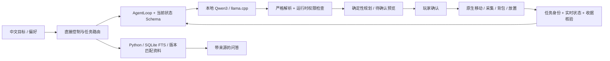

# Torchmate：Agent 架构与验证范围

模型负责理解目标和选择工具；程序保留执行权、资源预算和验收权。
当前使用 llama.cpp 提供本地 OpenAI 兼容接口；Qwen3-14B 是已用过的主要模型，
`qwen3-4b` 只是兼容旧配置的 API 别名，不表示实际模型参数量。



## 实现入口

| 层 | 当前实现与职责 |
| --- | --- |
| 模型协议 | `Content/Companion/AgentProtocol.cs`：工具及参数；`LocalModelClient`：传输与约束输出 |
| Agent 闭环 | `AgentLoop.cs`：观察→工具选择→执行结果回灌，参数修复、重复检测和收尾回合 |
| 状态约束 | `TaskRecovery.cs`、`ObservationPolicy.cs`：恢复、只读、停止及重规划对应不同 Schema；运行时再次检查 |
| 长任务 | 递归合成图、房屋／平台蓝图、园艺、有限地形与通道规划；预览不修改世界 |
| 原生执行 | `Content/Systems/`、`Content/Actions/`：移动、库存与箱子事务、实际 Tile 操作；以收据验收 |
| 失败恢复 | 当前原因、已确认部分、新库存回流；补查／询问／停止／原目标重规划，新预览需再次确认 |
| RAG | `scripts/brain/`：实体匹配、程序分析、Wiki FTS、游戏配方、版本隔离及来源；召唤条件保留来源分组 |
| 偏好记忆 | 按世界的本地存储和结构化经历；不是在线 RL 或模型参数训练 |
| 离线评测 | `evals/` 链接同一 AgentLoop 和纯规划／执行代码，原生 API 用明确的模拟适配器替代 |

约束解码减少无效输出，不等于行动授权。世界会在推理期间变化，因此所有实际执行仍需检查
访问身份、指令修订、目标范围、材料、工具、危险和有效确认。实际移除数量与入包数量分开报告。

## 自动化与实机的边界

无需游戏、GPU、模型或 Wiki 即可运行：

```powershell
python scripts/prepare_github.py --check
python -m unittest discover -s tests -p "test_*.py"
dotnet run --project tests/CompanionTests.csproj
dotnet run --project tests/native_replacement/NativeReplacementTests.csproj
dotnet run --project tests/terrain_route/TerrainRouteTests.csproj
dotnet run --project tests/tunnel_workshop/TunnelWorkshopTests.csproj
dotnet run --project tests/recovery_adapter/RecoveryAdapterTests.csproj
dotnet run --project tests/collaboration_adapter/CollaborationAdapterTests.csproj
dotnet run --project tests/recovery_eval/RecoveryEvalTests.csproj
python scripts/run_evals.py --validate
```

GitHub CI 只运行这些检查，不下载游戏、模型或 Wiki，不启动图形客户端。
安装匹配 tModLoader 后，本地构建另做程序集接线和包内容检查；它们也不能证明真实物理、
掉落、FPS、中文输入或鼠标交互已通过。0.10.34 的实机复测和补录已由玩家取消。

历史模型对照的协议、数字与局限见 [恢复评测](recovery-eval.md)。这是开发过程中修过反例的
固定回归集；历史结果不等于当前版本重新跑过，更不等于整个游戏的任务成功率。
当前没有 RL 训练结果。更远的产品目标见 [DESIGN](../DESIGN.md)，不代表已实现能力。
