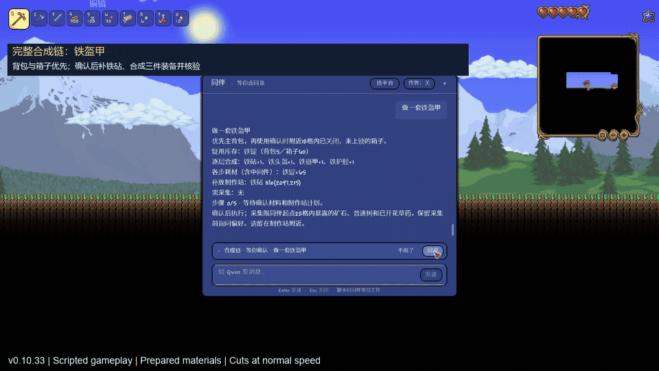

# Demo · 演示范围

The 29-second preview is excerpted from real **v0.10.33** gameplay recorded on
2026-10-21 with the local Qwen3-14B model. It shows an iron-armor crafting chain
and platform construction. Playback remains at normal speed, with cuts between excerpts.

This was a **scripted fixture** in a dedicated world: terrain and materials were
prepared, commands entered through the real coordinator, and confirmation used the real
confirmation entry points. The demonstrated armor chain uses backpack/chest stock and
adds an anvil; it does **not** show collecting all raw materials from an untouched world.
Model responses were not prewritten. The clip does not establish current v0.10.34
gameplay or clean-Windows acceptance.

Source excerpts from the local 541.7-second recording:

| Source interval | Content |
|---|---|
| 189.3–192.3 s | Iron-armor material/station preview |
| 208.5–216.5 s | Confirmation and verified armor delivery |
| 223.2–241.2 s | Platform preview and construction |

29 秒预览来自 2026-10-21 的 **0.10.33 真实游戏录屏**，连接本地 14B 模型，原速播放并剪去部分等待。
演示世界预置了地形和材料；调用真实指令与确认入口，模型答复没有预写。
铁盔甲片段展示背包／箱子取料、补放铁砧和成品核验，不代表从零采集整套原料。
它不是 0.10.34 的实机复测，不能替代当前版验收。

Gameplay visuals remain the property of their respective rights holders and are outside
the project's MIT grant; see [third-party notices](../THIRD_PARTY_NOTICES.md).
